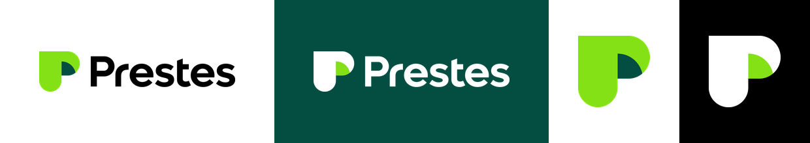
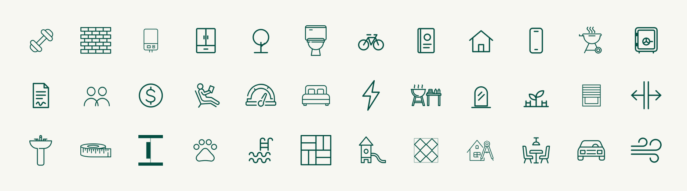
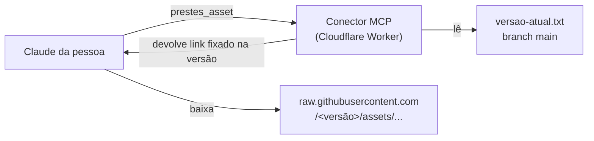

<p align="center">
  
</p>

<h1 align="center">Design System Prestes · Assets</h1>

<p align="center">
  Os arquivos oficiais da marca Prestes, versionados e prontos para usar em apresentações, posts e peças.<br>
  <sub>Desenvolvido e mantido por <b>Rafael Casteli</b> · Área de Marca · Prestes</sub>
</p>

<p align="center">
  
  
  
</p>

---

## O que tem aqui

<p align="center"></p>

| Grupo | Conteúdo | Formatos |
|---|---|---|
| **[Logos](assets/Logos)** | Logo horizontal e vertical (positiva e negativa), símbolo P e 5 avatares para redes | SVG + PNG |
| **[Grafismos](assets/Grafismos)** | Caixa de texto com portinha, linha com degrau e padronagem "portas abertas". Grafismos do Eleva You (prefixo `eleva-you_`), só para peças desse empreendimento | SVG + PNG |
| **[Ícones](assets/Icones)** | 36 ícones de linha (lazer, unidade e acabamento) em verde-escuro, com variante branca | SVG + PNG + PNG branco |
| **[Produtos](assets/Produtos)** | 32 logos de empreendimentos, recortados para layout e assinatura | PNG |
| **[Fachadas](assets/Fachadas)** | Imagem principal de 39 empreendimentos (≈ 1600 × 900) | JPG |

Cada pasta tem um `_LEIAME.md` com as regras de uso do grupo. Leia antes de aplicar.

<p align="center"></p>

---

## Como funciona

Os assets chegam às pessoas pelo **conector MCP do Design System Prestes**, que já entrega as regras da marca, as receitas e o catálogo de empreendimentos. Este repositório é a fonte dos arquivos: o conector devolve links daqui, fixados numa versão, e o ambiente de código do Claude baixa sem bloqueio.



Um link de asset tem esta cara:

```
https://raw.githubusercontent.com/Rafael-Casteli/prestes-ds-assets/1.0.2/assets/Logos/png/Prestes_Logo_Horizontal_Positiva_RGB.png
```

Como o link aponta para uma **tag**, uma peça feita com a versão `1.0.2` continua apontando para os mesmos arquivos, mesmo depois de publicadas versões novas.

---

## Versionamento

As versões seguem `MAIOR.MENOR.CORREÇÃO`, sem prefixo, e andam junto com a versão do Design System (a primeira publicação é a `1.0.2`):

| Mudança | Exemplo | Versão |
|---|---|---|
| Correção (cor, recorte, arquivo trocado) | PNG de um ícone regerado | `1.0.2 → 1.0.3` |
| Conteúdo novo | Novos ícones, novo empreendimento | `1.0.3 → 1.1.0` |
| Mudança que quebra (renomear ou remover arquivo) | Logo antigo retirado | `1.1.0 → 2.0.0` |

O arquivo **[`versao-atual.txt`](versao-atual.txt)** diz qual versão o conector serve. Mudou ele, mudou para todo mundo, sem novo deploy do conector e sem ninguém trocar o link.

### Publicar uma versão

```bash
node scripts/publicar.mjs                              # próxima correção (1.0.2 → 1.0.3)
node scripts/publicar.mjs 1.1.0 "Novos ícones de lazer" # versão escolhida
```

O script atualiza `versao-atual.txt`, gera o `manifest.json`, faz o commit, cria a tag e envia. Em até 5 minutos o conector já serve a versão nova.

### Voltar para uma versão anterior

```bash
node scripts/publicar.mjs --voltar 1.0.2
```

Nada é apagado: as tags antigas continuam lá, e o conector só passa a apontar para a escolhida.

---

## Estrutura

```
assets/
  <Grupo>/
    _LEIAME.md          regras de uso do grupo
    *.svg | *.png | *.jpg   arquivos originais
    png/                PNG gerado dos SVGs (+ *_branco.png nos ícones)
manifest.json           índice de todos os arquivos, gerado a cada versão
versao-atual.txt        versão que o conector serve
scripts/
  gerar-manifest.mjs
  publicar.mjs
```

A estrutura espelha `ds/assets` do conector, então um caminho vale nos dois lugares.

---

## Regras que andam junto com os arquivos

- Use sempre estes arquivos. **Nunca redesenhe a marca.**
- Logo **positiva** em fundo claro, **negativa** em verde-escuro ou preto.
- A portinha da caixa de texto **nunca distorce**: escale por igual.
- Verde Prestes `#84E115` nunca como texto sobre branco.
- A imagem de um empreendimento nunca fala de outro.
- Tipografia é só **Lufga**, que não está neste repositório: a licença é instalada em cada máquina.

O brand book completo está no conector (`prestes_guia`).

---

<p align="center">
  <sub>
    As marcas e elementos de identidade visual pertencem à Prestes. Organização e manutenção do design system por Rafael Casteli.<br>
    Pedidos de mudança no design system vão para Rafael Casteli. Veja <a href="LICENSE">LICENSE</a>.
  </sub>
</p>
